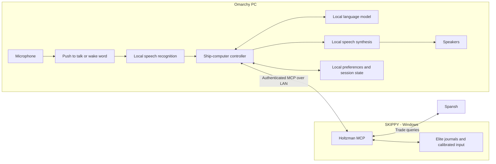

# Local voice ship computer

Proposed architecture, October 25, 2026. This describes a new client; it is
not an installed or benchmarked system.

For commands to prepare and test the individual components, see the
[Windows installation guide](windows-client-install.md) or
[Omarchy installation guide](omarchy-install.md). The combined voice
application is still to be implemented. Windows uses the same two-PC layout
described below, with Windows Credential Manager and Task Scheduler replacing
the Linux credential file and systemd services on the client PC.

## Deployment

Run the ship computer on the Omarchy PC. Keep Holtzman on SKIPPY alongside
Elite Dangerous. The microphone and ship-computer speakers connect directly
to Omarchy; game audio uses the gaming PC's speakers. No audio transport
between PCs is required.

All speech recognition, language-model inference, speech synthesis, dialogue
and action decisions run on Omarchy. Spansh remains an external data source:
local inference does not make trade searches work offline. The existing
Spansh adapter can remain in Holtzman initially; it performs HTTP queries,
not model inference. Splitting it into another server is unnecessary for
the first version.

Build a dedicated client application, provisionally `holtzman-voice`.
Codex can remain a development and administration client. Normal ship-computer
operation should start independently of a coding session.

## Starting stack

| Responsibility | Initial choice |
| --- | --- |
| Audio and conversation pipeline | Python application using Pipecat |
| Speech recognition | whisper.cpp with an English model and Silero speech detection |
| Language-model runtime | llama.cpp's `llama-server`, initially testing its Vulkan backend |
| Language-model candidate | Quantized Qwen3.5-35B-A3B with the matching vision projector for screenshot-guided docking; benchmark text and image requests |
| Speech synthesis | Audition Kokoro-82M locally; Piper is a simpler alternative |
| MCP connection | Persistent Streamable HTTP session to Holtzman, behind a policy wrapper |
| Preferences and short session history | Local SQLite database; fresh game facts come from Holtzman |
| Startup | systemd user services on Omarchy, with models kept loaded |

These are candidates to validate on the actual APU, driver and firmware
configuration. Do not assume that all 192 GB is available to GPU inference,
or that a model fitting in memory will respond quickly. Keep room for model
context, speech models and the desktop. Start with a moderate context window
and measure tool-call correctness and response latency before trying larger
models.

[llama.cpp's build documentation](https://github.com/ggml-org/llama.cpp/blob/master/docs/build.md)
describes Vulkan and HIP backends. Vulkan is the first backend to test here;
HIP/ROCm is an alternative to benchmark if compatible with the exact hardware
and Omarchy installation. Its
[function-calling documentation](https://github.com/ggml-org/llama.cpp/blob/master/docs/function-calling.md)
also makes the model's chat template part of the tool-calling configuration.
Validate the chosen model, quantization and template together. The
[Qwen model card](https://huggingface.co/Qwen/Qwen3.5-35B-A3B) is a candidate
reference, not a performance promise for this PC.

[whisper.cpp](https://github.com/ggml-org/whisper.cpp) supports local
transcription and Silero voice activity detection. Benchmark CPU speech
processing first, then acceleration if useful. Test Elite names such as
"AD Leonis", "Ross 248" and "Homer Platform" specifically. Supply relevant
names as recognition context where supported, and clarify ambiguous
destinations before executing an action.

[Kokoro-82M](https://huggingface.co/hexgrad/Kokoro-82M) and
[Piper](https://github.com/OHF-Voice/piper1-gpl) provide local speech synthesis
options. Pick a voice after listening through the actual speakers; maintain
a pronunciation dictionary for systems, stations, abbreviations and units.

[Pipecat's MCP client](https://github.com/pipecat-ai/pipecat/blob/main/src/pipecat/services/mcp_service.py)
supports Streamable HTTP. Use it as a library for the pipeline and connection,
with our own tool-dispatch policy. Some examples use hosted AI services;
explicitly configure every inference component locally and provide no cloud
fallback.

## Controller responsibilities

The controller is the MCP client. The language model proposes structured
tool calls; ordinary application code validates and executes them. Reuse the
existing HOLT ship-computer system prompt for personality, the Captain
relationship and conversational style. Load it from a versioned local file
on Omarchy so the same personality can be used with different local models.
Action boundaries and result verification remain enforced in code.

The prompt currently exists as `prompts/ship-computer.md` in the screenshot
development checkout. Its tool descriptions include capabilities beyond
the main checkout used for this architecture. During client implementation,
reconcile those descriptions with the connected server's discovered tools;
the prompt alone does not make a capability available. Screenshot-guided
docking requires image interpretation on Omarchy; SKIPPY only captures and
returns the game window.

The normal request path is:

1. Accept an addressed utterance and transcribe it.
2. Fetch the game facts needed for that request. Prefer live tool results
   over remembered location, cargo or cockpit state.
3. Let the model answer or propose a tool call with validated arguments.
4. For game input, check the request's authorization and current
   preconditions, announce the bounded action and execute it once.
5. Wait for evidence of the outcome, then speak a short factual result.

Expose read tools and trade planning normally. Expose `plot_route` through
the action wrapper. For docking, allow `press_binding` only within the
requested, bounded screenshot-guided workflow, observing each step before
continuing. Keep cursor recording and calibration tools in an explicit
maintenance mode. Preserve the server's input
allow-list and HOTAS bindings. Normal operation should not fall back to
arbitrary shell commands, raw keys or desktop control.

Serialize actions. A trade discussion can perform several read-only
searches, but must not automatically become plotting, buying, launching or
flying. Each live chore remains a short supervised action requested by the
commander. For an unclear system name or incompatible game state, ask one
concise question instead of guessing.

Keep compact, timestamped game snapshots and a rolling conversation summary.
Do not put entire journals or market dumps into every model request. Store
preferences such as voice, verbosity and trade filters separately from live
facts. Keep credentials outside model context and redact them from logs.

## Voice and immersion

Start with a push-to-talk button or foot switch connected to Omarchy. Add a
local wake word and a short follow-up listening window after the basic
pipeline works. Speech detection alone cannot distinguish a command from
game dialogue, a video or conversation nearby. This is relevant to the
background video speech heard during the earlier voice session.

The speaker wiring is settled. The remaining software work is preventing
the computer from responding to its own voice or unrelated speech. Echo
cancellation can use Omarchy's playback reference; it cannot be assumed to
remove audio from the separate gaming PC automatically. Begin with deliberate
turn-taking, then test interruption and wake-word behavior in the real room.

Use concise acknowledgements and verified outcomes:

> Captain: HOLT, plot a course to AD Leonis.
>
> HOLT: Plotting course, Captain.
>
> HOLT, after confirmation: Course plotted. Three jumps.

The jump count above is illustrative and must come from the current result.
Do not narrate individual keys, menu steps or internal tools in ordinary use.
Keep diagnostics in a separate transcript/log. Speak failures with a useful
next step, such as "Route not confirmed. The galaxy map is still open."
Only state that a panel is open when current telemetry supports it.

Trade conversations should use the current ship, free cargo space and
location, compare a few opportunities with price freshness, and allow natural
follow-ups such as "exclude carriers" or "find a shorter trip". An itinerary
is advice; plotting its next destination is a separate requested action.

Keep speech interruptible and routine telemetry quiet. Start with a brief
listening tone and optional completion tone; personality should not delay
commands or produce periodic "still working" announcements. Optimize and
measure the time to first useful speech separately from tool completion.
An acknowledgement can be quick while the calibrated route recipe still
takes several seconds.

## Connection and operation

The current server address is `http://skippy:7777/mcp`, using bearer
authentication. Store the client credential in a protected file or systemd
credential on Omarchy. Do not include it in prompts, source control, speech
or diagnostic output. Bind inference endpoints to loopback.

Keep `skippy` as a valid server Host value. `allowed_hosts` validates the HTTP
Host; it is not a source-PC access list. Use a scoped Windows firewall rule
for network access and an encrypted tunnel or TLS if the bearer credential
must cross an untrusted network. Preserve the working server config and
click calibration during client setup.

Maintain one persistent MCP session with bounded timeouts and reconnects.
Retrying a read after reconnect is different from retrying game input. A
timeout does not prove that a route action failed or was canceled. Recheck
the journal before considering another attempt, and never silently replay
an action on reconnect.

Use two main services initially: the model server and the voice application.
The application can own speech workers and MCP lifecycle. Pin tested model
files, runtime versions and configuration. A small local status view can
show listening, processing, acting and disconnected states without making a
dashboard a prerequisite.

## Existing docking support and remaining server work

Docking calibration and station-selection visibility are now solved through
screenshots in the current supervised workflow. Use `screenshot` to inspect
the Contacts tab, expected station and Request Docking selection, and
`press_binding` with `observe: true` to inspect the result of each allowed
control action. Confirm the outcome against fresh matching
`DockingRequested`, `DockingGranted` or `DockingDenied` journal events. A
dedicated `request_docking` tool would package this existing capability; it
is not a prerequisite for screenshot-guided docking.

The [earlier docking calibration](docking-calibration.md) records the original
keyboard sequence and journal checks. Its journal-only visibility limitation
is addressed by the newer screenshots. On the two-PC setup, capture stays
on SKIPPY and vision inference runs on Omarchy. Enable and validate the
local model's image-input path before using this docking workflow from the
new voice client. The text-only model smoke test in the installation guide
does not exercise that path.

Action cancellation remains additional server work: the route recipe has
no explicit cancellation tool. Interrupting speech or canceling a client
request is not a guarantee that game input stopped. Add server-side
cancellation, action status and held-input cleanup before offering "stop"
as a reliable action abort.

## Implementation order

1. Verify the exact APU, RAM, GPU-visible memory and Linux graphics backend.
   Benchmark a local model against real Holtzman tool schemas using fixtures,
   including ambiguous destinations, stale data and malformed calls.
2. Make the Omarchy controller connect to Holtzman and answer text requests
   using read tools and trade planning. Keep game actions disabled initially.
3. Add local microphone transcription, local speech synthesis and deliberate
   turn-taking. Test names, background game/video audio, interruption and
   end-to-end latency. Enable local vision and check screenshot interpretation
   of the station highlight and docking action before sending controls.
4. Enable one supervised `plot_route` request through the policy wrapper,
   starting from verified game state and confirming the destination afterward.
   Then validate the existing screenshot-guided docking workflow through
   the local client, with the commander supervising.
5. Add wake word, pronunciation polish and any explicitly requested alerts.
   Develop action cancellation as a separate Holtzman change.

The first useful milestone is a voice conversation about ship status and
nearby trade opportunities, followed by one explicitly requested, verified
route plot. No retraining or custom voice model is required to reach it.
