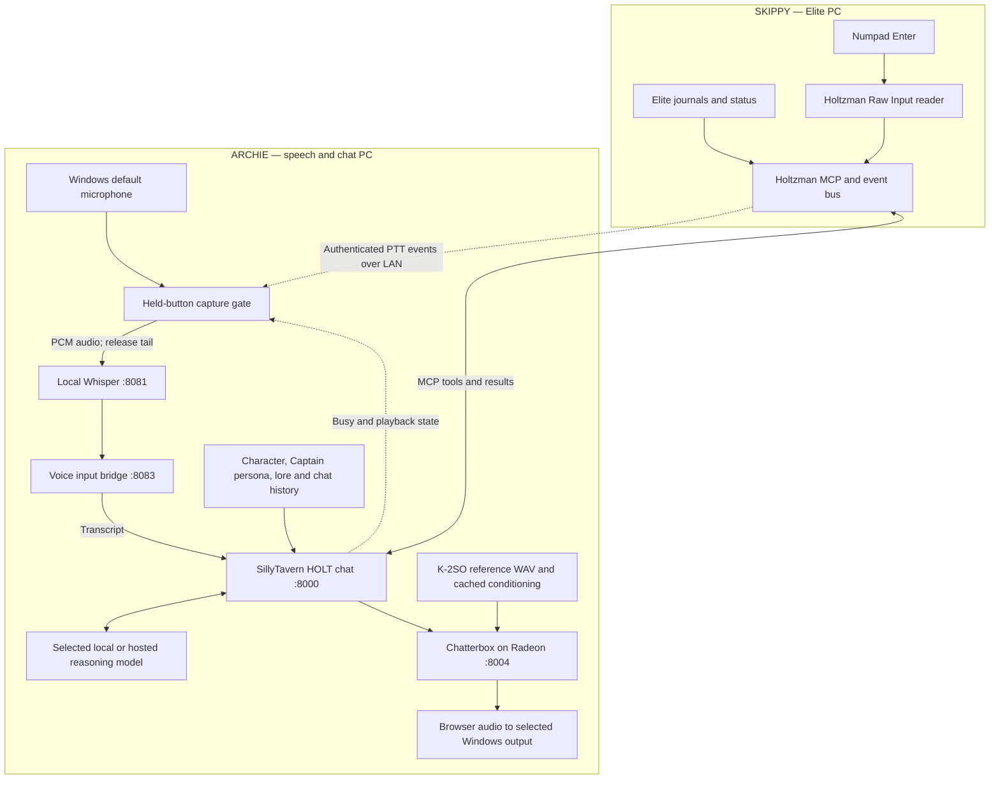

# Standalone HOLT speech and Numpad Enter PTT

Updated 2026-11-01 after reviewing upstream main through `d78c6bc`.
This describes the standalone SillyTavern installation in
`C:\Users\chris\SillyTavern`, not the older HOLT reasoning gateway.



The key is pressed on **SKIPPY**. The microphone and playback remain on **ARCHIE**.
Only the button state crosses this part of the LAN connection; no microphone
audio is routed through SKIPPY. Holtzman observes the key rather than consuming
or remapping it, so it still reaches Elite. Main keyboard Enter is not PTT.

## New upstream features

Commit `58b0115` adds authenticated SSE `/events`, long polling via `events_since`,
and `/ptt` learn/configuration. Events include snapshots, resets, PTT edges,
journal/status changes and action activity. Snapshots/reset resynchronise state;
they are not fresh alerts. Numbered events support recovery after disconnection.

New MCP tools are `ship_action`, `cancel_action`, `action_status`, `events_since`,
`captains_log`, `voyage_report`, `log_entry`, `objectives`, `session_briefing` and
`plan`. Reconnect/refresh Holtzman in the ST MCP extension to discover updated tools.
Build-ID fixes in `1df1797` and `d78c6bc` make the reported running commit reliable
when using the server update script.

The new desktop/gateway engine also has command reflexes, adaptive endpointing
and callouts. Those are separate from this standalone input bridge. This bridge
does not dispatch game commands, replace the reasoning backend, add another TTS
engine or silently activate reflexes. ST's MCP extension owns its tool loop.

## Numpad Enter support

Upstream's initial PTT whitelist did not include keypad Enter. The follow-up here
adds **`Key_NumpadEnter`** to validation, keyboard-device selection and Raw Input
decoding. `VK_RETURN` is accepted only with the E0 flag, for both press and release;
ordinary Enter remains unsupported. Regression coverage checks this distinction.
See [Microsoft's Raw Input keyboard flags](https://learn.microsoft.com/en-us/windows/win32/api/winuser/ns-winuser-rawkeyboard).

On SKIPPY, update/build/restart Holtzman **before** saving this configuration:

```powershell
cd C:\Users\chris\holtzman
git pull --ff-only
powershell.exe -NoProfile -ExecutionPolicy Bypass -File scripts/update-holtzman-server.ps1
```

Then the ST panel's **Configure Numpad Enter** button uses the authenticated `/ptt`
endpoint to save the input. The equivalent section in SKIPPY's `holtzman.toml` is:

```toml
[ptt]
inputs = ["Key_NumpadEnter"]
tail_ms = 150
max_hold_s = 30
```

Do not add this new value to an old binary and assume it will start. The deployed
server checked at the start of this task exposed `/ptt`, but reported `input: null`;
keypad support and physical keypresses were not live-validated at that point.

## ARCHIE installation and operation

Portable extension source: `integrations/sillytavern/voice-input`. Install it into
the **standalone** ST installation while ST is stopped, then reopen/reload ST:

```powershell
cd C:\Users\chris\holtzman
Copy-Item -LiteralPath integrations/sillytavern/voice-input -Destination C:/Users/chris/SillyTavern/public/scripts/extensions/third-party/holt-voice-input -Recurse
```

That copy command is for a new installation. For updates, copy the source folder's
contents into the existing `holt-voice-input` folder, rather than nesting it.
Dependencies are those of the existing HOLT `voice-env`; Chatterbox keeps its own
GPU environment. No provider credentials are copied into the browser extension.

```powershell
.\HOLT-ST-Voice.cmd start
.\HOLT-ST-Voice.cmd status
.\HOLT-ST-Voice.cmd stop
.\HOLT-Chatterbox.cmd start
```

In ST, select the HOLT chat and open **Extensions → HOLT voice input**. Configure
Numpad Enter after the server update, then select **Start listening**. Hold the
key on SKIPPY while speaking into ARCHIE's Windows default microphone; release it to
finish. A 150 ms tail preserves the end of the utterance. There is also a bounded
maximum hold. **Stop listening** closes microphone capture; the command-line
`stop` closes the input bridge and a Whisper process it started itself.

Whisper starts on demand using the installed CPU small-English runtime/model.
An already healthy transcription server is reused and not stopped by this bridge.
Ollama, Chatterbox, ST and the old HOLT reasoning gateway are not stopped. The
bridge uses ARCHIE's Windows default recording device, ignoring the older desktop
client's saved microphone selection. After changing the Windows input device,
select Stop listening, then Start listening to refresh and reopen capture.
Playback uses the browser's Windows audio routing. No Windows defaults are changed.

The browser must remain open. SSE ticks keep the voice-panel heartbeat operating
while the game has focus; fully suspending or closing the page expires the lease
and inhibits capture. Select Start again after a ship-link reset/disconnect.

## Turn handling

The bridge accepts held-button speech only. Capture is inhibited while ST is
generating, Chatterbox is processing, or browser TTS is playing. Presses during
that period require release before recording can rearm; this first version is
half-duplex, without speech interruption/barge-in.

One tab/chat owns a renewable lease. A transcript carries a trace receipt and chat
identity. Chat/link changes invalidate pending audio; expired transcripts are not
replayed. ST persists the receipt with the user message before generation, preventing
an uncertain response or backend failure from automatically replaying a game request.
Spoken slash-command text remains ordinary chat text; it is not executed as STscript.

The local service binds to `127.0.0.1:8083`; control requests are limited to the
two configured ST origins on port 8000. The Holtzman bearer token is read from
Windows Credential Manager and used by the native SSE/configuration client only.
The local log is `.local/holt/results/st-voice.log`; keep it private.
`HOLT-ST-Voice.cmd status` also reports the actual microphone stream state and
counts of received PTT presses, captured speech segments and Whisper responses.
These diagnostics omit speech text. If no transcript appears, the first counter
that does not advance identifies the stage to check. A recovered microphone
stream clears its earlier microphone error rather than leaving a stale warning.
The status response includes `capture_status` for chat/playback pauses and
`input_level` with frame counts and RMS levels (no audio or transcript content).
Refresh ST after updating the extension to show pause reasons in its voice panel.
Generation gating reads ST's exported `isGenerating()` on each poll. Do not latch
`GENERATION_STARTED`: prompt-preview dry runs emit it without necessarily emitting
an end event, which previously left input permanently paused despite a working mic.

### Local-model tool schema compatibility

Install `integrations/sillytavern/tool-schema-compat` as the standalone ST extension
`public/scripts/extensions/third-party/holt-tool-schema-compat`, then refresh ST.
It also works with typed chat and does not require microphone capture. At request
preparation it rewrites boolean property schemas into equivalent object schemas:
`true` becomes `{}`, and `false` becomes `{"not": {}}`. It preserves boolean data
in defaults/enums, closed-object constraints, tool names and the complete catalogue.

Ollama's OpenAI-compatible tool decoder rejected Holtzman's legal unconstrained
`objectives.measure: true` schema with HTTP 400 (`cannot unmarshal bool ...
parameters.properties ... api.ToolProperty`). A direct test with the actual local
`qwen3-coder-next:q8_0` model and all 33 tools reproduced that 400, then returned
HTTP 200 with `measure: {}`. No game tools were executed during validation.

## Validation record

- Python regression suite: 107 tests passed, including eight input-bridge tests.
- Browser-extension contract tests: three Node tests passed (normal chat submission,
  duplicate/failure receipt handling and wrong-chat rejection).
- Rust changed files formatted with the pinned Rust formatter; Numpad Enter decode,
  press/release and main-Enter exclusion tests added. Full Rust tests/Windows compile
  are delegated to the repository's existing Linux/Windows CI, since this PC has no
  complete Cargo/linker toolchain installed.
- Physical PTT/microphone use remains pending the SKIPPY binary update and a live
  keypress test. Offline tests use fake audio/events and send no game controls.

Live read-only discovery found **33 MCP tools**, including all ten new tools
listed above, on server build **`d78c6bc7ae73`**. The bridge's authenticated SSE
connection reported connected with PTT up and no configured input. The standalone
ST extension was installed and its panel was checked in the browser. Clicking
Start before configuration correctly refused capture with a clear setup message;
the local bridge remained disabled with no pending transcript. Its start/stop/status
commands were also exercised. None of these checks sends game input.
